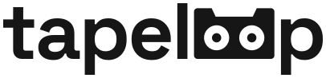
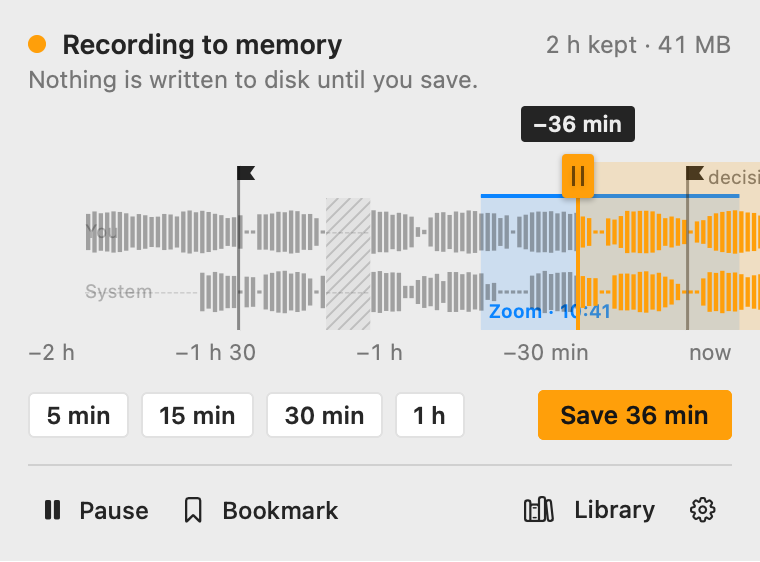

<p align="center">
  <picture>
    <source media="(prefers-color-scheme: dark)" srcset="docs/images/wordmark-on-dark.svg">
    
  </picture>
</p>

<h3 align="center">Record the past.</h3>

<p align="center">
  A free, open-source menu bar app that keeps the last hours of your microphone and your Mac's sound in memory,<br>
  so you can save a conversation after it happened.
</p>

<p align="center">
  <a href="https://github.com/harshaxnim/tapeloop/releases/latest"><b>Download for Mac</b></a> ·
  <a href="https://tapeloop.stream">tapeloop.stream</a> ·
  <a href="https://tapeloop.stream/docs/">Docs</a>
</p>

<p align="center">
  <picture>
    <source media="(prefers-color-scheme: dark)" srcset="docs/images/popover-recording-dark.png">
    
  </picture>
</p>

- **Always recording, never keeping.** Two hours of both sources by default, compressed in memory. Nothing is
  written to disk until you save.
- **Rewind, then keep.** Drag back on the timeline, or press ⌃⌥S anywhere, and get an ordinary `.m4a` file.
- **Meetings, caught whole.** Calls in Zoom, Teams, FaceTime, Meet and others are marked and offered for saving.
- **Words, on your Mac.** Optional transcripts with NVIDIA Parakeet or Apple's on-device speech recognition.
- **Barely there.** About 1 % of one CPU core, 13 MB plus the audio held, no disk writes
  ([performance report](docs/PERFORMANCE.md)).
- **Private by design.** No account, no analytics. The only network request is the optional speech-model download,
  made when you ask.

Requires macOS 14 or later (system audio needs 14.2). Apple silicon and Intel.

## Build from source

```sh
make app      # build/Tapeloop.app (run scripts/dev-signing.sh once so rebuilds keep their permissions)
make test     # 137 tests
make dmg      # build/Tapeloop-0.1.0.dmg
```

Xcode 16 or later. See [CONTRIBUTING](CONTRIBUTING.md), [architecture](docs/ARCHITECTURE.md),
[testing](docs/TESTING.md) and the [changelog](CHANGELOG.md).

## Licence

MIT. Transcription uses [transcribe.cpp](ThirdParty/TranscribeCpp) (MIT) and the NVIDIA Parakeet model
(CC BY 4.0); see [THIRD_PARTY_NOTICES](THIRD_PARTY_NOTICES.md). Recording other people may require their consent
where you live.
