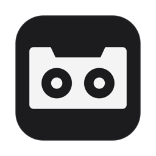
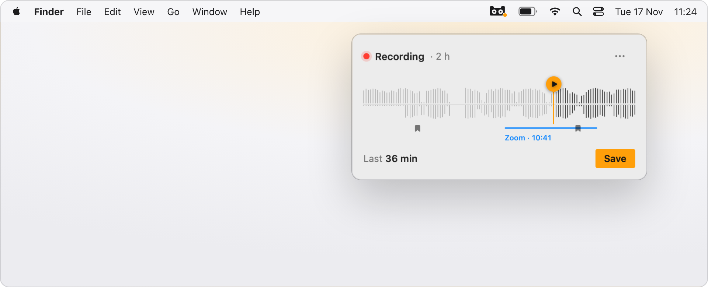

<p align="center">
  <a href="https://tapeloop.stream"></a>
</p>

<p align="center">
  <a href="https://tapeloop.stream">
    <picture>
      <source media="(prefers-color-scheme: dark)" srcset="docs/images/wordmark-on-dark.svg">
      
    </picture>
  </a>
</p>

<p align="center">
  <b>Record the past.</b><br>
  A free, open-source menu bar app that keeps the last hours of your microphone and your Mac's sound in memory,
  so you can save a conversation after it happened.
</p>

<p align="center">
  <a href="https://github.com/harshaxnim/tapeloop/releases/latest"></a>
</p>

<p align="center">
  
  
  <a href="LICENSE"></a>
  <a href="https://github.com/harshaxnim/tapeloop/actions/workflows/ci.yml"></a>
</p>

<p align="center">
  <a href="https://tapeloop.stream"><b>Website</b></a> ·
  <a href="https://tapeloop.stream/docs/"><b>Docs</b></a> ·
  <a href="https://tapeloop.stream/docs/performance/">Performance</a> ·
  <a href="CHANGELOG.md">Changelog</a> ·
  <a href="https://github.com/harshaxnim/tapeloop/issues">Report an issue</a>
</p>

<p align="center">
  <picture>
    <source media="(prefers-color-scheme: dark)" srcset="docs/images/hero-dark.png">
    
  </picture>
</p>

- **Always recording, never keeping.** Two hours of both sources by default, compressed in memory. Nothing is
  written to disk until you save.
- **Rewind, listen, keep.** Drag the handle back, press play to hear it without saving, then save an ordinary
  `.m4a` file, or press ⌃⌥S in any app.
- **Meetings, caught whole.** Calls in Zoom, Teams, FaceTime, Meet and others are marked and offered for saving.
- **Words, on your Mac.** Optional transcripts with NVIDIA Parakeet or Apple's on-device speech recognition.
- **Barely there.** About 1 % of one CPU core, 13 MB plus the audio held, no disk writes
  ([performance report](docs/PERFORMANCE.md)).
- **Private by design.** No account, no analytics. The only network request is the optional speech-model download,
  made when you ask.

## Install

1. Download `Tapeloop-0.1.0.dmg` from [Releases](https://github.com/harshaxnim/tapeloop/releases/latest) and drag
   Tapeloop to Applications.
2. Open it. This build is not notarized, so the first time right-click it and choose **Open** (macOS 15: System
   Settings › Privacy & Security › **Open Anyway**).
3. The welcome guide asks for the microphone and system audio permissions. Then the cassette in the menu bar is
   recording.

macOS 14 or later; system audio needs macOS 14.2. The full guide is at
[tapeloop.stream/docs](https://tapeloop.stream/docs/).

## Build from source

```sh
make app      # build/Tapeloop.app (run scripts/dev-signing.sh once so rebuilds keep their permissions)
make test     # 142 tests
make dmg      # build/Tapeloop-0.1.0.dmg
```

Xcode 16 or later. See [CONTRIBUTING](CONTRIBUTING.md), [architecture](docs/ARCHITECTURE.md),
[testing](docs/TESTING.md) and the [changelog](CHANGELOG.md).

## Licence

MIT. Transcription uses [transcribe.cpp](ThirdParty/TranscribeCpp) (MIT) and the NVIDIA Parakeet model
(CC BY 4.0); see [THIRD_PARTY_NOTICES](THIRD_PARTY_NOTICES.md). Recording other people may require their consent
where you live.
